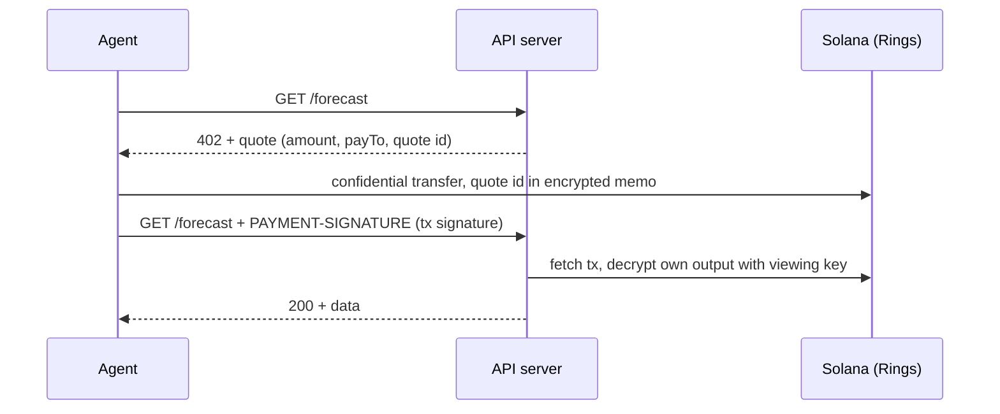

# ring402

x402 payments where the amount stays private.

Demo, running on devnet: https://ring402-demo.vercel.app

An API answers `402 Payment Required`, the caller pays with a confidential transfer on [Solana Privacy Rings](https://www.helius.dev/docs/privacy), and the API serves the request. The chain shows that wallet A paid wallet B. It does not show how much or in which token.

Pay more than the price and the rest becomes prepaid credit, so later calls don't touch the chain at all.

Status: works end to end on devnet with SOL and SPL tokens. Alpha, unaudited. Don't put real money through it.

## Why

With normal x402 every payment is a public token transfer. Anyone can read what an API charges, how much it earns, and what a given agent spends and where. That's fine for a demo and a problem for a business.

Rings hide the asset and the amount of a transfer. Sender and recipient stay public in the default Ring, so this is confidentiality, not anonymity. For paid APIs that's the part that matters.

## How it works



The server can't spend. It holds the merchant's address and viewing key, nothing else. It decrypts the output addressed to it, checks the amount and the quote id in the memo, and recomputes the onchain commitment.

Each 402 carries a fresh quote id. The payment is bound to it through the encrypted memo, the quote is tied to the route and price it was issued for, and it's consumed on use. A replayed payment gets a new 402.

The agent keeps a per-transaction viewing key for every payment. Handing it to someone lets them open that one payment and nothing else in the wallet's history.

If the agent pays more than the price, the server keeps the rest as credit and returns a session token. Later calls send the token and are charged offchain. See [Sessions](#sessions).

On the wire it's x402 v2: the same `PAYMENT-REQUIRED`, `PAYMENT-SIGNATURE` and `PAYMENT-RESPONSE` headers and field names as the [spec](https://github.com/coinbase/x402), with a new scheme called `confidential`.

## Try it

You need Rust, a [Helius API key](https://dashboard.helius.dev/), and a Solana CLI wallet with some devnet SOL.

```bash
cp .env.example .env
```

Put your key in `.env`, then start the server:

```bash
cargo run --example server
```

Hit the paid route without paying:

```bash
curl -i http://127.0.0.1:4020/forecast
```

```
HTTP/1.1 402 Payment Required
payment-required: eyJ4NDAyVmVyc2lvbiI6Mi...

{"x402Version":2,"error":"PAYMENT-SIGNATURE header is required","resource":{"url":"/forecast"},
 "accepts":[{"scheme":"confidential","network":"solana:EtWTRABZaYq6iMfeYKouRu166VU2xqa1",
 "amount":"3000000","asset":"11111111111111111111111111111111","payTo":"bnycay11f7kz...",
 "maxTimeoutSeconds":120,"extra":{"quote":"153901a632396a0f84917c562a757332","sessions":true}}]}
```

Now let the agent pay for it, in a second terminal:

```bash
cargo run --example agent
```

```
private balance  14000000
call 1           200 OK
  onchain        10000000 in 61dFyQviBAD4Pd72g1Mfx1Y5XcAVLU8WurGdBRvdh6dZetaau1gtVva2wBtYiPWetYtZLm1V1pi3N6mvv4EfWXxP
  credit left    7000000
  {"city":"Bengaluru","tomorrow":"light rain","high_c":27}
call 2           200 OK
  onchain        nothing
  credit left    4000000
  {"city":"Bengaluru","tomorrow":"light rain","high_c":27}
call 3           200 OK
  onchain        nothing
  credit left    1000000
  {"city":"Bengaluru","tomorrow":"light rain","high_c":27}
```

Three calls, one onchain payment. The agent prepaid 0.01 SOL on the first call and the other two came out of that credit. It deposits into its private balance first if it's running low.

## Demo page

There's a copy running at https://ring402-demo.vercel.app. To run it yourself:

```bash
cargo run --example demo
```

Open http://127.0.0.1:4020 and press send. Each request is a real paid call on devnet. The first one pays onchain, the next few run on session credit, and the agent tops up when the credit runs out. The page shows the latest payment four ways: as anyone reads it from the chain, as the merchant's viewing key opens it, as the agent's receipt key opens it, and as a random key fails to. It links the transaction on Solana Explorer so you can check for yourself that the amount isn't there. The x402 headers for each request are underneath.

### Running it on a server

The demo is one process that keeps sessions and quotes in memory, so it wants a host that runs a container: Vercel's container runtime, Fly.io, Railway, Render, or a VM. On hosts that stop idle containers (Vercel does after five minutes), a restart starts over with a fresh merchant and no session credit, which is fine for a demo.

Build the image:

```bash
docker build -t ring402-demo .
```

It reads its settings from the environment:

| Variable | What it is |
|---|---|
| `HELIUS_API_KEY` | Your Helius key. Required. |
| `PAYER_SECRET` | The agent wallet, as the JSON array from a keypair file. Required in a container. |
| `PAYER_KEYPAIR` | Path to the agent's keypair file, used when `PAYER_SECRET` isn't set. Defaults to `~/.config/solana/id.json`. |
| `PORT` | Port to listen on. The image sets 80. |
| `HOST` | Address to bind. The image sets `0.0.0.0`. |
| `PAYMENTS_PER_HOUR` | Onchain payments the demo will make per hour. Each one prepays six requests. Default 20. |
| `MINT` | Price the APIs in this SPL token instead of SOL. |

Use a separate wallet for the agent, not your main one, and keep only a little devnet SOL in it. Anyone who opens the page can spend from it, up to `PAYMENTS_PER_HOUR`. The demo moves 0.108 SOL from it into the agent's private balance whenever that runs low, so keep at least that much there.

```bash
solana-keygen new --no-bip39-passphrase -o .keys/demo-payer.json
```

```bash
solana airdrop 1 $(solana-keygen pubkey .keys/demo-payer.json) -u devnet
```

Put the contents of that file in your host's secret settings as `PAYER_SECRET`, along with `HELIUS_API_KEY`. Never bake either into the image; `.dockerignore` keeps `.env` and `.keys/` out of it.

To try the image locally:

```bash
docker run --rm -p 8080:80 -e HELIUS_API_KEY -e PAYER_SECRET="$(cat .keys/demo-payer.json)" ring402-demo
```

On Vercel there is nothing to configure: it finds the `Dockerfile` at the project root, builds it, and sends traffic to port 80. Add the two secrets, then deploy:

```bash
vercel env add HELIUS_API_KEY production
```

```bash
vercel env add PAYER_SECRET production < .keys/demo-payer.json
```

```bash
vercel deploy --prod
```

Errors sent to the browser have the API key cut out of them, and onchain payments, the paid route, the balance lookup and the demo calls each have an hourly cap so a busy page can't drain the wallet or your Helius credits. Requests paid from credit don't count toward the payment cap. Behind a proxy that sets `X-Forwarded-For`, as Vercel does, each visitor also gets their own limit: 20 demo calls and 200 other requests an hour, so one script can't use up the shared caps.

## Sessions

Paying per call has a leak. If the price is public, anyone can count the transfers between two wallets and multiply. Sessions close that.

- The 402 offer says `"sessions": true`.
- The agent pays any amount at or above the price. The server charges the price and keeps the rest as credit.
- The response carries a session token and the remaining balance in `PAYMENT-RESPONSE` under `extensions.session`.
- Later calls send `PAYMENT-SESSION: <token>`. The server debits the credit and serves. No transaction, no proof, no waiting on the chain.
- When credit runs out the server answers 402 again. Paying with the token attached tops up the same session.
- If a handler returns a 5xx, the charge goes back to the session. If that call was paid onchain, the price becomes credit instead of being lost.

What an observer sees is one transfer of unknown size per top-up. Not the number of calls, not the price, not the total.

Credit is shared across every route behind the same `Paywall`. `PAYMENT-SESSION` and the `extensions.session` object are this crate's own additions, not part of the x402 spec.

## Tokens

Prices can be in SOL or in any SPL token registered with Rings. USDC is registered on both devnet and mainnet. To see everything that is:

```bash
cargo run --example assets
```

A token needs its Rings asset id, which `Helius::mint` looks up onchain:

```rust
use ring402::usdc;

let token = helius.mint(usdc::DEVNET)?;
let paywall = Paywall::new(helius, SOLANA_DEVNET, pay_to, viewing_key);
let layer = paywall.price(token, 10_000);
```

Amounts are in the token's smallest unit, so `10_000` is 0.01 USDC. `Helius::mint` is a blocking call, so do it before you start the async runtime, the way `examples/server.rs` does.

The examples take the token from a `MINT` variable:

```bash
MINT=4zMMC9srt5Ri5X14GAgXhaHii3GnPAEERYPJgZJDncDU cargo run --example server
```

```bash
MINT=4zMMC9srt5Ri5X14GAgXhaHii3GnPAEERYPJgZJDncDU cargo run --example agent
```

That needs devnet USDC in your wallet, which [Circle's faucet](https://faucet.circle.com) hands out. If you'd rather not, make your own 6-decimal token and register it with Rings:

```bash
spl-token create-token --decimals 6 -u devnet
```

```bash
spl-token create-account <MINT> -u devnet
```

```bash
spl-token mint <MINT> 100 -u devnet
```

```bash
cargo run --example register <MINT>
```

Session credit is kept per token. SOL credit won't pay for a route priced in USDC.

## Server

```rust
use axum::{routing::get, Router};
use ring402::{helius::Helius, server::Paywall, wire::SOLANA_DEVNET};
use spr_transaction::Mint;

let paywall = Paywall::new(Helius::devnet(&api_key), SOLANA_DEVNET, pay_to, viewing_key);

let app = Router::new()
    .route("/", get(index))
    .route("/forecast", get(forecast).layer(paywall.price(Mint::SOL, 3_000_000)));
```

`pay_to` is the merchant's shielded address and `viewing_key` is its viewing key. The signing key never has to be on the server.

`Paywall` talks to the chain through a small `Ledger` trait, so you can swap Helius for your own indexer or a fake in tests.

## Client

```rust
use ring402::{client::Agent, helius::Helius};
use spr_transaction::SOL_MINT;

let agent = Agent::new(Helius::devnet(&api_key), &keypair)?
    .spend_limit(SOL_MINT, 5_000_000)
    .prepay(SOL_MINT, 10_000_000);

let paid = agent.get("http://127.0.0.1:4020/forecast").await?;
println!("{}", paid.response.text().await?);
```

`get` handles the 402, pays from the private balance, and retries.

Limits are per token. The agent only pays in tokens you gave it a `spend_limit` for, and refuses any price above that limit. For USDC, pass `usdc::DEVNET` or `usdc::MAINNET` instead of `SOL_MINT`.

With `prepay` set, the agent pays that amount when a server offers sessions, remembers the session token per origin, and uses it on later calls. Leave it out to pay the exact price every time.

`paid.receipt` is there when the call paid onchain: the transaction signature, the quote, and the one-payment viewing key. `paid.credit` is the session balance left with that server.

To check a receipt later, fetch the transaction and open it with that key:

```rust
use ring402::Opener;

let payment = receipt.quote.settle(&tx, Opener::Disclosed(&receipt.key))?;
```

## Layout

| File | What's in it |
|---|---|
| `src/lib.rs` | `Quote`, and `settle`, which verifies a payment from an indexed transaction |
| `src/wire.rs` | x402 v2 types and header encoding |
| `src/server.rs` | the Axum/tower paywall layer |
| `src/client.rs` | the paying agent |
| `src/helius.rs` | RPC, indexer and prover through one Helius endpoint |

Features: `server` and `client` are both on by default. Turn off default features to get only the verification core.

## Tests

```bash
cargo test
```

The tests build and encrypt real transactions with the Zolana SDK but don't touch the network. They cover view-only settlement, one-payment disclosure, replay, a cheap quote used on an expensive route, underpayment, a tampered commitment, malformed headers, token payments, and sessions: credit, top-ups, running out, per-token balances, and refunds on a failed handler.

## What's missing

- I haven't paid with real USDC yet. Token payments were run on devnet with a 6-decimal test mint. USDC is registered with Rings on devnet and mainnet and goes through the same code.
- A route takes one token. It can't offer SOL and USDC side by side.
- Quotes and session credit sit in memory. A restart drops them, so prepaid credit is lost, and it won't run as multiple instances. Keep top-ups small until there's a real store.
- No refunds. The server only has a viewing key, so it can't send unused credit back. That's the cost of a server that can't spend.
- Session tokens are bearer tokens. Whoever has the token can spend the credit, so use TLS.
- No facilitator. The agent submits the transfer itself and the server looks it up. Standard x402 clients won't understand the `confidential` scheme.
- Devnet only. Mainnet isn't tested.

## Notes

The Zolana crates are pulled from git at the commit Helius pins in their own examples, since there's no crates.io release matching the deployed programs yet. Expect that to change.

Built on [Zolana](https://github.com/helius-labs/zolana) and [x402](https://github.com/coinbase/x402).

## License

MIT
